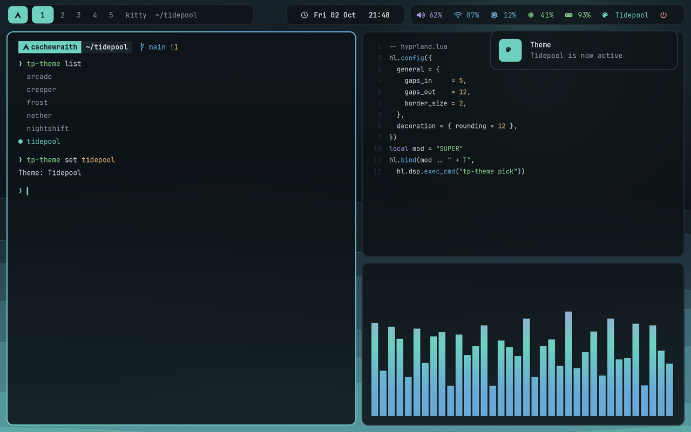
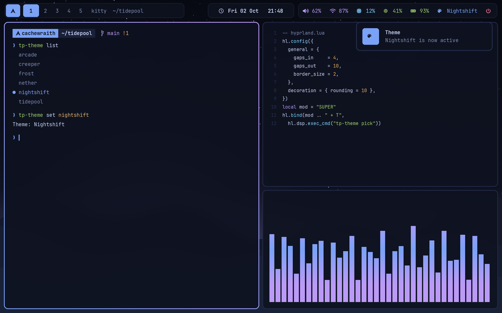
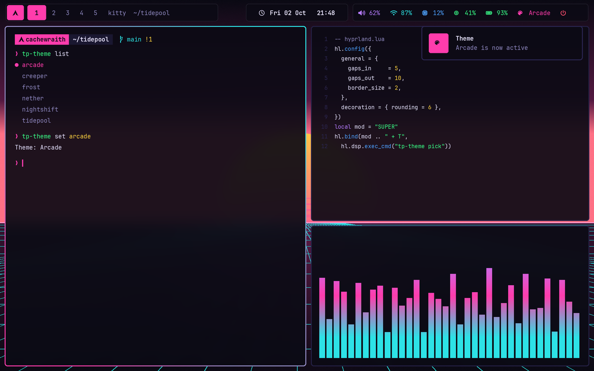
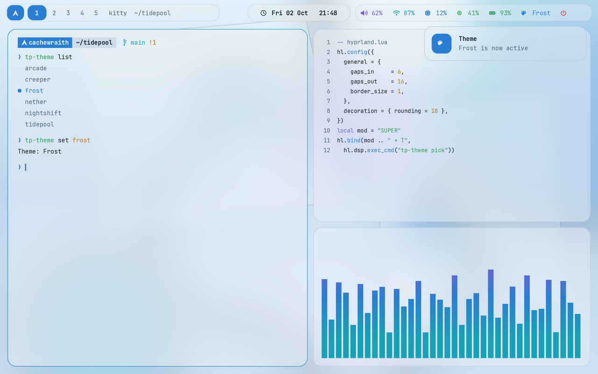
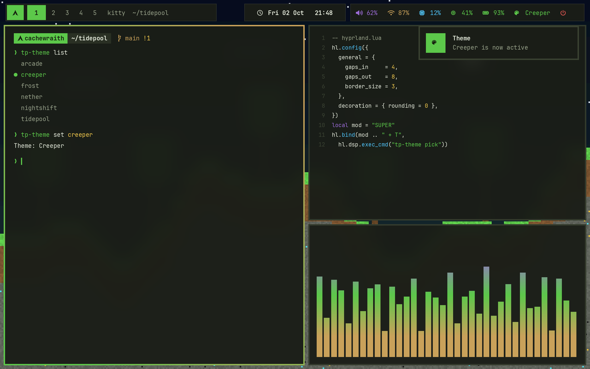
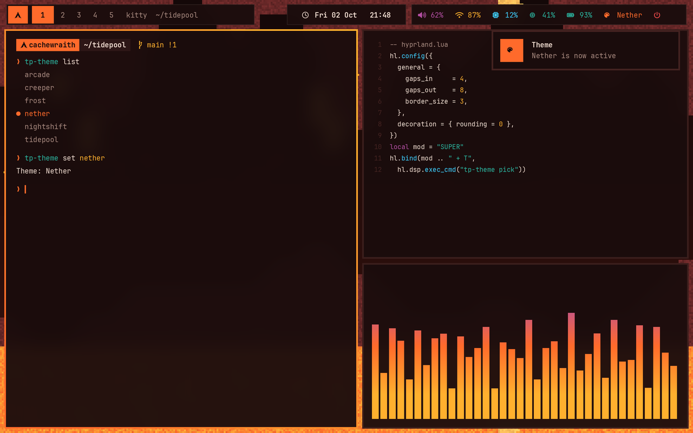

<div align="center">

# 🌊 Tidepool

**A themeable Hyprland rice for Arch Linux. Six themes, one palette file each, the whole desktop recolors together.**

[](https://hypr.land)
[](https://archlinux.org)
[](https://wiki.hypr.land)
[](https://wayland.freedesktop.org)



</div>

Tidepool ships six themes you can switch at any time, smooth animations, glass blur, sound effects, a styled bash prompt and a one-key game mode. Each theme is a single `palette.sh`. Changing the theme re-renders Hyprland, Waybar, Rofi, Kitty, notifications, the lock screen, the prompt, fzf, cava, the wallpaper and the sound pack in one step.

## Contents

- [Themes](#themes)
- [Features](#features)
- [Install](#install)
- [Keybinds](#keybinds)
- [Make your own theme](#make-your-own-theme)
- [Game mode and Minecraft](#game-mode-and-minecraft)
- [Shell](#shell)
- [Commands](#commands)
- [Project layout](#project-layout)
- [Troubleshooting](#troubleshooting)

## Themes

<table>
  <tr>
    <td align="center" width="50%"><br><b>tidepool</b> · everyday<br><sub>Deep teal, rounded, soft blur</sub></td>
    <td align="center" width="50%"><br><b>nightshift</b> · developer<br><sub>Navy and violet, syntax-friendly colors, tight gaps</sub></td>
  </tr>
  <tr>
    <td align="center"><br><b>arcade</b> · gaming<br><sub>Near-black violet, neon magenta and cyan, chiptune sounds</sub></td>
    <td align="center"><br><b>frost</b> · glassy<br><sub>Light, translucent panels, heavy blur</sub></td>
  </tr>
  <tr>
    <td align="center"><br><b>creeper</b> · Minecraft<br><sub>Square corners, thick borders, grass green, pixel-art wallpaper</sub></td>
    <td align="center"><br><b>nether</b> · Minecraft<br><sub>Square corners, thick borders, lava orange, pixel-art wallpaper</sub></td>
  </tr>
</table>

<sub>The previews are drawn from each theme's palette and wallpaper by <code>tools/gen_previews.py</code>, using that theme's real colors, rounding, borders, gaps and opacity. They are mockups, not screenshots.</sub>

Switch with <kbd>SUPER</kbd>+<kbd>T</kbd> (picker), <kbd>SUPER</kbd>+<kbd>SHIFT</kbd>+<kbd>T</kbd> (next), <kbd>SUPER</kbd>+<kbd>CTRL</kbd>+<kbd>T</kbd> (random), the palette button in the bar, or `tp-theme set <id>`.

## Features

- **One palette, every app.** Hyprland borders, rounding, gaps, blur and opacity, plus Waybar, Rofi, Kitty, swaync, hyprlock, starship, fzf, cava and the wallpaper all follow the active theme.
- **Hyprland Lua config** for 0.55 and newer, split into sections that load independently, so one mistake does not take down the rest.
- **Floating glass bar.** Waybar is drawn as three blurred islands with workspaces, media, audio, network, CPU, memory, temperature, battery, theme and game-mode buttons.
- **Sound packs.** Generated `soft`, `arcade`, `blocky` and `glass` packs play on startup, notifications, volume, screenshots, theme changes and the terminal bell.
- **Game mode.** One key turns off animations, blur, shadows, gaps and rounding and enables tearing. Games and Minecraft stay opaque, low-latency and never trigger the lock screen while fullscreen.
- **Safe install.** Existing configs are moved to a timestamped backup, never deleted, and `./uninstall.sh` puts them back.

## Install

**Requirements:** Arch Linux (or an Arch-based distro) and **Hyprland 0.55 or newer**, the first release with the Lua config format. Check with `Hyprland --version`.

```bash
git clone https://github.com/cachewraith/tidepool.git ~/tidepool
cd ~/tidepool
./install.sh
```

Then log out and start Hyprland from your login screen, or run `start-hyprland`.

The installer:

1. Asks before installing the base packages with `pacman` (and, separately, the optional gaming packages).
2. Moves any config it replaces into `~/.config-backup-tidepool-<time>/`.
3. Links the files from this folder into `~/.config` and the `tp-*` commands into `~/.local/bin`, so editing the repo edits your desktop.
4. Adds one line to `~/.bashrc`, renders the starting theme, and runs `Hyprland --verify-config`.

| Option | Effect |
|---|---|
| `--theme <id>` | Start with a different theme, for example `--theme frost` |
| `--no-packages` | Only link configs, install nothing |
| `--yes`, `-y` | Install the base packages without asking (skips the gaming packages) |

<details>
<summary><b>Packages installed</b></summary>

**Base:** `hyprland hypridle hyprlock hyprpolkitagent xdg-desktop-portal-hyprland waybar rofi kitty swaync swaybg wl-clipboard cliphist grim slurp jq libnotify brightnessctl playerctl pipewire pipewire-pulse wireplumber pavucontrol ttf-jetbrains-mono-nerd starship eza bat fzf zoxide fastfetch btop cava thunar gvfs bash-completion`

**Gaming and Minecraft (optional):** `prismlauncher jdk21-openjdk gamemode mangohud`

To install them yourself:

```bash
sudo pacman -S --needed hyprland hypridle hyprlock hyprpolkitagent xdg-desktop-portal-hyprland \
  waybar rofi kitty swaync swaybg wl-clipboard cliphist grim slurp jq libnotify brightnessctl \
  playerctl pipewire pipewire-pulse wireplumber pavucontrol ttf-jetbrains-mono-nerd starship \
  eza bat fzf zoxide fastfetch btop cava thunar gvfs bash-completion
```

</details>

**Update:** `cd ~/tidepool && git pull`. Configs are symlinks, so changes apply on the next reload. Run `tp-theme set "$(tp-theme current)"` to re-render the themed files.

**Uninstall:** `./uninstall.sh` removes the links and generated files and restores your backups. It does not remove packages.

## Keybinds

<kbd>SUPER</kbd> is the Windows key.

| Keys | Action |
|---|---|
| <kbd>SUPER</kbd> <kbd>Return</kbd> | Terminal (kitty) |
| <kbd>SUPER</kbd> <kbd>B</kbd> / <kbd>E</kbd> | Browser / file manager |
| <kbd>SUPER</kbd> <kbd>Space</kbd> | App launcher |
| <kbd>SUPER</kbd> <kbd>Tab</kbd> | Window switcher |
| <kbd>SUPER</kbd> <kbd>M</kbd> | Menu: themes, screenshots, game mode, sound, power |
| <kbd>SUPER</kbd> <kbd>V</kbd> | Clipboard history |
| <kbd>SUPER</kbd> <kbd>N</kbd> | Notification center |
| <kbd>SUPER</kbd> <kbd>Q</kbd> / <kbd>SHIFT</kbd> <kbd>Q</kbd> | Close / force kill |
| <kbd>SUPER</kbd> <kbd>F</kbd> / <kbd>SHIFT</kbd> <kbd>F</kbd> | Fullscreen / floating |
| <kbd>SUPER</kbd> arrows or <kbd>H</kbd><kbd>J</kbd><kbd>K</kbd><kbd>L</kbd> | Focus |
| <kbd>SUPER</kbd> <kbd>SHIFT</kbd> arrows or <kbd>H</kbd><kbd>J</kbd><kbd>K</kbd><kbd>L</kbd> | Move window |
| <kbd>SUPER</kbd> <kbd>CTRL</kbd> arrows or <kbd>H</kbd><kbd>J</kbd><kbd>K</kbd><kbd>L</kbd> | Resize |
| <kbd>SUPER</kbd> <kbd>1</kbd>…<kbd>0</kbd> | Workspace 1 to 10 |
| <kbd>SUPER</kbd> <kbd>SHIFT</kbd> <kbd>1</kbd>…<kbd>0</kbd> | Send window to workspace |
| <kbd>SUPER</kbd> <kbd>S</kbd> / <kbd>SHIFT</kbd> <kbd>S</kbd> | Show scratchpad / send window to it |
| <kbd>SUPER</kbd> <kbd>G</kbd>, <kbd>[</kbd> <kbd>]</kbd> | Tabbed group: toggle, previous, next |
| <kbd>SUPER</kbd> <kbd>Y</kbd> / <kbd>P</kbd> | Toggle split / pseudotile |
| <kbd>SUPER</kbd> left / right mouse drag | Move / resize window |
| <kbd>Print</kbd>, <kbd>SHIFT</kbd> <kbd>Print</kbd>, <kbd>ALT</kbd> <kbd>Print</kbd> | Screenshot: area, full screen, window |
| <kbd>SUPER</kbd> <kbd>T</kbd> / <kbd>SHIFT</kbd> <kbd>T</kbd> / <kbd>CTRL</kbd> <kbd>T</kbd> | Theme: pick / next / random |
| <kbd>SUPER</kbd> <kbd>F10</kbd> | Game mode |
| <kbd>SUPER</kbd> <kbd>F9</kbd> | Sounds on or off |
| <kbd>SUPER</kbd> <kbd>Escape</kbd> | Lock |
| <kbd>SUPER</kbd> <kbd>SHIFT</kbd> <kbd>E</kbd> | Exit Hyprland |

Volume, brightness and media keys work too, including on the lock screen.

## Make your own theme

```bash
tp-theme new mytheme nightshift     # copy an existing theme
$EDITOR themes/mytheme/palette.sh   # change colors and style values
tp-theme set mytheme
```

A palette needs 14 color lines:

```bash
BASE="#0d1317"     MANTLE="#121a20"   SURFACE="#19232b"   OVERLAY="#24313b"
TEXT="#d3dde3"     SUBTEXT="#8a9ba6"  ACCENT="#6fd0c0"    ACCENT2="#6aa9d6"
ON_ACCENT="#0d1317" GREEN="#8fd694"   YELLOW="#e2b872"    RED="#e08a82"
BLUE="#6aa9d6"     MAUVE="#a99ae0"
```

Style values are optional and fall back to defaults: `ROUNDING`, `BORDER`, `GAPS_IN`, `GAPS_OUT`, `OPACITY_ACTIVE`, `OPACITY_INACTIVE`, `BLUR_SIZE`, `BLUR_PASSES`, `BLUR_VIBRANCY`, `SHADOW_RANGE`, `SHADOW`, `BAR_ALPHA`, `BAR_RADIUS`, `WIN_ALPHA`, `FONT_UI`, `FONT_MONO`, plus `THEME_KIND` (`dark` or `light`) and `SOUND_PACK`.

Put your own image at `wallpapers/mytheme.png`, or the Tidepool wallpaper is used. The generators can rebuild the bundled assets:

```bash
python3 tools/gen_wallpapers.py    # wallpapers (needs Pillow and numpy)
python3 tools/gen_sounds.py        # sound packs
python3 tools/gen_previews.py      # README previews (needs Pillow)
```

## Game mode and Minecraft

<kbd>SUPER</kbd> <kbd>F10</kbd> (or `tp-gamemode toggle`) turns off animations, blur, shadows, gaps and rounding, enables tearing, and lights up the bar button. Steam games, gamescope and Minecraft windows are always opaque, allowed to tear, and keep the screen awake while fullscreen.

`tp-mc` starts Prism Launcher (or the official launcher), switches to the Creeper theme, turns on game mode, and restores your theme when the launcher closes. Set `TP_MC_THEME=nether` for the other Minecraft theme, or `TP_MC_KEEP_THEME=1` to keep yours.

## Shell

Open a new terminal after installing. You get a starship prompt colored by the active theme, showing the directory, git status and language versions, plus `eza`, `bat`, `fzf` (<kbd>Ctrl</kbd>+<kbd>R</kbd> history, <kbd>Ctrl</kbd>+<kbd>T</kbd> files, <kbd>Alt</kbd>+<kbd>C</kbd> folders), `zoxide` (`z projects`), a large shared history and short aliases:

```
ls ll la lt     eza with icons
gs gl gd gp     git status, log, diff, push
d dc dcu dcl    docker, compose, up, logs
art pn          php artisan, pnpm
ff              fastfetch
theme game mc   tp-theme, game mode, Minecraft session
fcd             fuzzy cd into any folder below you
```

## Commands

| Command | What it does |
|---|---|
| `tp-theme list \| current \| set <id> \| next \| prev \| random \| pick \| new` | Themes |
| `tp-menu` | The <kbd>SUPER</kbd> <kbd>M</kbd> menu |
| `tp-gamemode on \| off \| toggle` | Game mode |
| `tp-sound <name> \| on \| off \| toggle` | Sounds |
| `tp-screenshot area \| full \| window` | Screenshot to `~/Pictures/Screenshots` and the clipboard |
| `tp-volume up \| down \| mute \| mic` | Volume with sound feedback |
| `tp-brightness up \| down` | Brightness |
| `tp-mc` | Minecraft session |

## Project layout

```
config/      files linked into ~/.config (hyprland.lua, hypridle, waybar, rofi, kitty, fastfetch, bash)
templates/   themed files; tp-theme fills them from a palette and writes them to ~/.config
themes/      one palette.sh per theme
bin/         the tp-* commands, linked into ~/.local/bin
sounds/      WAV sound packs
wallpapers/  one wallpaper per theme
tools/       generators for wallpapers, sounds and README previews
docs/        README images
```

Do not edit `theme.lua`, `hyprlock.conf`, Waybar's and swaync's `style.css`, `theme.rasi` or kitty's `theme.conf` in `~/.config`, because every theme change rewrites them. Edit the template or the palette instead. Personal Hyprland overrides go in `~/.config/hypr/user.lua`:

```lua
return { terminal = "alacritty", browser = "zen-browser", files = "nautilus" }
```

## Troubleshooting

<details>
<summary><b>An error popup on login, or a section missing</b></summary>

The Lua config is split into sections that load independently, and a failing section shows a notification naming it. Run `Hyprland --verify-config` for the exact file and line.
</details>

<details>
<summary><b>Wrong resolution or monitor layout</b></summary>

Run `hyprctl monitors`, then add a line next to the catch-all `hl.monitor` in `config/hypr/hyprland.lua` with your output name, for example:

```lua
hl.monitor({ output = "DP-1", mode = "2560x1440@144", position = "0x0", scale = 1 })
```
</details>

<details>
<summary><b>Icons show as boxes</b></summary>

Install a Nerd Font (`ttf-jetbrains-mono-nerd`) and make sure your terminal uses it.
</details>

<details>
<summary><b>No sound</b></summary>

Sounds need `pipewire` (for `pw-play`). Check `tp-sound status`, and <kbd>SUPER</kbd> <kbd>F9</kbd> to unmute.
</details>

<details>
<summary><b>Blur looks wrong</b></summary>

Blur applies to layers (Waybar, Rofi, notifications) and to transparent windows. Kitty's opacity is `WIN_ALPHA` in the palette.
</details>

<details>
<summary><b>Back to a plain setup</b></summary>

`./uninstall.sh` removes everything Tidepool linked or generated and restores your backed-up files.
</details>

---

<div align="center"><sub>A <i>rice</i> is a customized desktop, <i>dotfiles</i> are the config files that make it up, and a <i>theme</i> is only the colors. Tidepool is a rice, shared as dotfiles.</sub></div>
